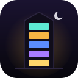

# Afterglow

Personal tracker for games, movies, series, anime and manga, with PlayStation-style trophies. The successor to [Nightshelf](https://github.com/Mark-Stessl/nightshelf), rebuilt from scratch.

Every category is a room in one long building at night, side by side from left to right: a cinema for movies, a game room with consoles, a living room TV for series and anime, a reading nook for manga, and a trophy room with the trophy display case, stats and calendar.

- Concept and build order: [docs/CONCEPT.md](docs/CONCEPT.md)
- Names, icon, palettes and cover styles: [docs/concept-board.html](docs/concept-board.html)

Status: planning. No app code yet.
